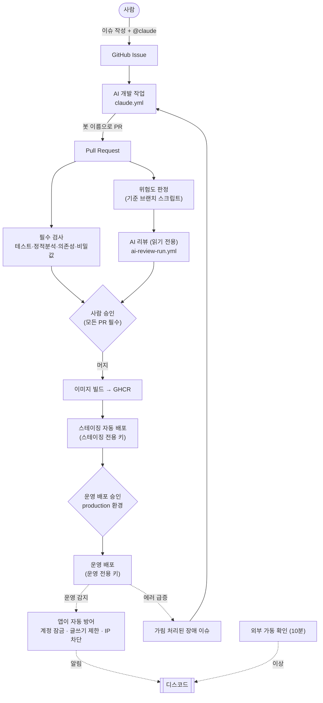

# AI Collab Pipeline

**AI가 작성하고, 사람이 승인한다.**
깃헙 이슈 하나가 AI(Claude Code)의 작업 → 자동 검사 → 위험도 판정 → 사람 승인 → 스테이징 → 승인 후 운영까지 이어지고,
운영 중 이상이 생기면 앱이 스스로 막고 알린 뒤 같은 길로 복구 작업이 돌아오는 협업 구조를 실제로 동작하게 만든 포트폴리오 프로젝트입니다.

- 연습용 앱: 라라벨 13 게시판(가입·로그인·글쓰기) + 보안 감지 모듈
- 협업 도구: 깃헙(이슈·PR·Actions) + 디스코드(알림)
- 서버: VPS 1대(도커), 기존 사이트와 같은 서버에서 격리 운영
- 스테이징 https://acp-staging.trueway.kr · 운영 https://acp.trueway.kr

## 한 장 구조도



## 사람이 하는 일, AI가 하는 일

| 역할 | 누가 | 할 수 있는 것 | 할 수 없는 것 |
|---|---|---|---|
| 요청·승인 | 사람(저장소 소유자) | 이슈 작성, PR 리뷰·승인·머지, 운영 배포 승인 | — |
| **AI 개발** | 봇 `acp-ai-bot-yoosook75` (`claude.yml`, `incident.yml`) | 코드 수정, `claude/` 브랜치 푸시, PR 생성 | main 푸시, 머지, 승인, 워크플로 수정, 서버·배포 비밀값 접근 |
| **AI 리뷰** | 같은 봇, 읽기 전용 토큰 (`ai-review-run.yml`) | 코드 읽기, 리뷰 댓글 | 파일 수정, 커밋·푸시, PR 생성·수정·머지·승인 |
| 자동화 | GitHub Actions, 앱 | 검사, 위험도 라벨, 알림, 스테이징 배포, 되돌릴 수 있는 방어 조치 | 운영 배포(승인 필요), 서버 구성 변경(수동 반영) |

**원칙: 되돌릴 수 있는 방어 조치는 자동, 코드 변경과 운영 배포는 반드시 사람 승인.**

## AI가 운영에 닿을 수 없는 이유

AI 작업은 "임의의 코드 실행"으로 간주합니다. 그래서 보장은 AI에게 주는 도구 목록이 아니라, **AI가 아예 닿을 수 없는 구조**에서 나옵니다.

1. **배포 키는 환경별로 따로, 환경 안에만 있습니다.** AI 작업 잡에는 `environment`가 없어 배포 비밀값을 볼 수 없습니다.
2. **키마다 배포할 환경이 서버에서 고정됩니다.** 스테이징 키로 `deploy prod`를 보내면 서버가 거부합니다(`authorized_keys`의 강제 명령, [deploy/deploy.sh](deploy/deploy.sh)).
3. **운영 배포는 `production` 환경의 사람 승인 뒤에만** 실행됩니다. 스테이징·운영 모두 main 브랜치에서만 배포됩니다.
4. **main은 보호됩니다.** PR 필수, 필수 검사 통과, 모든 PR에 소유자 승인(CODEOWNERS `*`) — 봇의 승인으로는 머지되지 않고, Actions는 PR을 승인할 수 없습니다.
5. **봇에게 워크플로·패키지 권한이 없습니다.** AI는 자기 권한이나 배포 절차를 바꿀 수 없습니다.
6. **운영 이미지는 공유 캐시 없이 빌드합니다.** AI 작업이 쓸 수 있는 빌드 캐시가 운영 이미지에 섞이지 않습니다.
7. **서버 구성(compose, Caddy)은 수동 반영입니다.** 저장소가 바뀌어도 서버 구성은 사람이 반영하기 전까지 그대로입니다.

이 구조는 독립 검토 2회(앱 / 파이프라인)를 거쳐 다듬었습니다. 검토에서 나온 "스테이징 키로 운영 배포 가능", "AI가 쓸 수 있는 캐시를 운영 빌드가 재사용" 같은 경로를 모두 막았습니다.

## 위험도 기반 승인 게이트

[.github/risk-paths.txt](.github/risk-paths.txt)에 있는 경로(인증, 보안 감지, 마이그레이션, 워크플로, 도커·배포 설정, 의존성 잠금 파일 등)를 건드리면:

- `risk:high` 라벨, 디스코드 "사람 확인 필요" 알림
- AI 리뷰가 "고위험 변경 요약"(무엇을 / 왜 / 영향 범위)을 PR 본문 맨 위에 붙임
- 판정 스크립트는 **PR이 아니라 기준 브랜치의 것**을 씀 — PR이 자기 위험도를 속일 수 없음

## 운영 감지와 자동 방어

| 감지 | 자동 대응 | 해제 |
|---|---|---|
| 같은 계정 로그인 5회 실패 | 계정 잠금 | 본인이 **이메일 인증 코드**로 해제(15분 유효, 5회 오입력 시 무효) |
| 스팸성 글 폭주·같은 내용/링크 반복 | 글쓰기 제한, 최근 글 **숨김**(삭제 아님) | 이메일 인증 코드 |
| 취약 경로 탐색(`/.env`, `/wp-admin` 등) | IP 1시간 차단(건별 알림 없음, 아래 일일 요약으로 확인) | 시간 경과 또는 관리자 로그인 |
| 과도한 요청(5분 300회) | IP 30분 차단, 즉시 알림 | 시간 경과 또는 디스코드 알림의 **서명 링크**(24시간) |
| 서버 전체 `.env` 접근(공용 Caddy 접속 기록, AI 호출 없음) | 매일 09:00 KST 전체 건수·응답 코드별·사이트별 요약 1회. HTML이 아닌 2xx 응답(실제 노출 의심)은 5분 안에 즉시 경보 | — |
| 같은 오류 급증(5분 10회) | 개인정보·비밀값을 가린 **장애 이슈** 자동 생성 → AI가 분석·수정 PR | 사람 승인 |
| 사이트 다운·느림·인증서 만료 임박(기존 사이트 포함) | 알림 | — |

안전장치:
- 관리자 계정은 잠기지 않음(대신 로그인 시도 속도 제한)
- Caddy 뒤 실제 IP는 신뢰 프록시 대역에서만 인정
- 장애 이슈는 중복 방지·하루 상한
- 2xx이면서 HTML인 응답은 SPA가 홈페이지를 대신 돌려준 것으로 보고 노출로 세지 않음(해시로 확인함)
- 추가 분석은 쿼리 값·IP 끝자리·헤더를 가린 기록만 사용

서버 쪽 보안(2026-11-26):
- SSH는 키로만 접속
- 시스템 로그 30일 보관
- 조사용 원본 로그는 해시와 함께 자동 삭제 대상 밖에 따로 보존

자세한 내용은 [deploy/server-setup.md](deploy/server-setup.md)에 있습니다.

## 실제 기록

| 장면 | 링크 |
|---|---|
| 첫 PR: 앱 + 파이프라인 전체, 필수 검사 통과 | [#1](https://github.com/yoosook75/ai-collab-pipeline/pull/1) |
| 이슈로 AI에게 작업 요청 → 봇 PR → `docker/` 수정이라 `risk:high` | [이슈 #8](https://github.com/yoosook75/ai-collab-pipeline/issues/8) → [PR #9](https://github.com/yoosook75/ai-collab-pipeline/pull/9) |
| 첫 실행에서 발견한 문제를 고치고 AI 개발·리뷰 역할 분리 | [PR #10](https://github.com/yoosook75/ai-collab-pipeline/pull/10) |
| 일반 기능 요청(페이지 번호) → AI가 테스트 먼저 작성 → 봇이 직접 PR → `risk:low` → 읽기 전용 AI 리뷰 → 사람 승인 | [이슈 #11](https://github.com/yoosook75/ai-collab-pipeline/issues/11) → [PR #12](https://github.com/yoosook75/ai-collab-pipeline/pull/12) |
| 시연용 에러 경로(스테이징·관리자 전용)를 AI에게 요청 | [이슈 #14](https://github.com/yoosook75/ai-collab-pipeline/issues/14) → [PR #15](https://github.com/yoosook75/ai-collab-pipeline/pull/15) |
| 장애 시연: 에러 급증 → 가림 처리된 장애 이슈 자동 생성 → AI가 "의도된 시연 오류"로 판단하고 **수정 PR을 만들지 않음** | [이슈 #16](https://github.com/yoosook75/ai-collab-pipeline/issues/16) |
| 방어 시연: 스팸 6번째 글에서 글쓰기 제한·숨김 → 이메일 코드로 해제, 로그인 5회 실패 잠금 → 이메일 코드로 해제, IP 차단 → 서명 링크로 해제 | 스테이징에서 수동 시연 |
| 시연 중 발견한 불편 3건을 이슈로 → AI PR | [이슈 #17](https://github.com/yoosook75/ai-collab-pipeline/issues/17) → [PR #18](https://github.com/yoosook75/ai-collab-pipeline/pull/18) |
| 실제 공격 대응: 외부 스캐너의 `/.env` 탐색이 실서버에서 자동 차단됨 → 서버 점검(SSH 무차별 대입 8천여 건 확인) → SSH 키 전용 전환, 로그 보존·30일 보관, `.env` 일일 요약으로 알림 소음 정리 | [PR #19](https://github.com/yoosook75/ai-collab-pipeline/pull/19) |
| 정기 점검: Dependabot 의존성 업데이트(Node 24 전환 3건 검토 후 머지, 쓰지 않는 2건 닫음) | [#2~#6](https://github.com/yoosook75/ai-collab-pipeline/pulls?q=author%3Aapp%2Fdependabot) |

## 다른 언어로 옮기려면

언어에 따라 바뀌는 건 [.github/workflows/checks-php.yml](.github/workflows/checks-php.yml) 하나입니다(테스트·정적분석·의존성 검사).
타입스크립트라면 `npm test`·`npm audit`, 파이썬이라면 `pytest`·`pip-audit`로 바꾸고 잡 이름 `checks`만 유지하면,
AI 작업·위험도·리뷰·알림·배포 흐름은 그대로 씁니다. 알림도 [.github/actions/notify](.github/actions/notify)의 `provider`로 디스코드·슬랙을 바꿉니다.

## 운영 메모

- **비밀값 목록**(값 없음, 위치·만료·재발급 방법): [docs/operations/secrets.md](docs/operations/secrets.md)
- **서버 설정 기록과 Caddy 변경 규칙**: [deploy/server-setup.md](deploy/server-setup.md) — Caddy는 기존 사이트와 공유하는 단일 입구라 "백업 → 덧붙이기 → 검증 → reload(재시작 금지)"로만 바꿉니다.
- **토큰 만료**: Claude 토큰(1년)과 장애 이슈용 토큰(1년)은 만료 30일 전부터 디스코드로 알림이 옵니다.
- **예약 워크플로 60일 규칙**: 공개 저장소는 60일 동안 활동이 없으면 깃헙이 `uptime`·`token-expiry` 같은 예약 워크플로를 자동으로 끕니다. Actions 탭 → 해당 워크플로 → **Enable workflow**로 다시 켭니다. 오래 운영한다면 외부 가동 확인 서비스를 함께 쓰는 것을 권장합니다.

## 로컬 개발

```bash
composer install && cp .env.example .env && php artisan key:generate
vendor/bin/pest                      # Windows(Laragon)처럼 pdo_sqlite가 꺼져 있으면: php -d extension=pdo_sqlite -d extension=sqlite3 vendor/bin/pest
vendor/bin/pint --test
vendor/bin/phpstan analyse --memory-limit=1G
bash .github/scripts/test-classify-risk.sh && bash deploy/test-deploy-args.sh && bash .github/scripts/test-days-until.sh
```

설계와 계획: [설계 문서](docs/superpowers/specs/2026-11-26-ai-collab-pipeline-design.md) · [구현 계획](docs/superpowers/plans/2026-11-26-ai-collab-pipeline-phase1.md) · AI 작업 규칙 [CLAUDE.md](CLAUDE.md)

## 깃헙 화면 용어 한글 대조표

| 화면에 보이는 말 | 뜻 | 이 프로젝트에서 |
|---|---|---|
| Issue | 할 일·요청 한 건 | 작업 요청, 장애 이슈 |
| Pull request (PR) | "이 변경을 합쳐 주세요" 요청 | AI·사람이 만든 변경 |
| Files changed | PR에서 바뀐 파일과 줄 | 리뷰할 때 보는 탭 |
| Review changes → Approve | 리뷰 후 승인 | 봇 PR은 이걸 먼저 누른 뒤 머지 |
| Request changes | 수정 요청 | 줄 댓글에 `@claude ...`로 AI에게 재작업 요청 가능 |
| Merge pull request | 합치기 | 승인 후 |
| Create a merge commit / 병합 커밋 생성 | 커밋 기록을 그대로 남기며 합치기 | 이 프로젝트의 기본 방식 |
| Squash and merge | 커밋을 하나로 뭉쳐 합치기 | 사용 안 함(작업 과정이 사라짐) |
| Bypass rules and merge / 규칙 우회 및 병합 | 보호 규칙을 건너뛰고 합치기 | 소유자가 직접 쓴 PR에만 사용 |
| Checks | 자동 검사 결과 | `php-checks / checks`, `secret-scan`이 필수 |
| Actions | 자동화 실행 기록 | 배포·검사·AI 작업 로그 |
| Review deployments → Approve and deploy | 배포 승인 | 운영 배포 승인 |
| Cancel workflow | 실행 취소 | 오래된 배포 대기 정리 |
| Secrets / Variables | 비밀값 / 일반 설정값 | 토큰, 주소 |
| Environments | 배포 대상별 설정과 승인 규칙 | `staging`, `production` |
| Rulesets / Branch protection | 브랜치 보호 규칙 | main 직접 푸시 금지 등 |
| Labels | 분류 꼬리표 | `risk:high`, `risk:low`, `incident` |
| Dependabot | 의존성 자동 업데이트 봇 | 매주 월요일 |
| Fork | 남의 저장소 복사본 | 포크에서 온 PR에는 AI가 동작하지 않음 |
